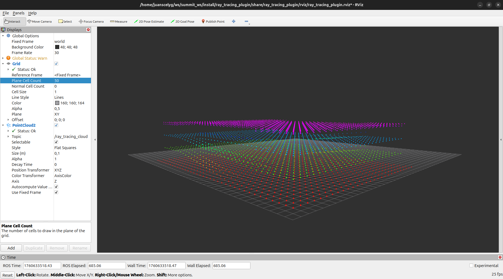

# Ray Tracing Plugin


[](https://github.com/juanscelyg/ray_tracing_plugin/actions/workflows/main.yaml)

This repository contains a **Gazebo plugin** that implements a **ray tracing system** to create a PointCloud message in Gazebo and ROS 2. It is designed to integrate with robotic simulation environments, enabling the calculation of ray intersections with objects in the virtual world.



---

## Features

- Ray Tracing using Gazebo plugin.
- Compatible with **Gazebo Harmonic** (the Gazebo of ROS 2 Jazzy).
- Implemented in **C++** with support for configuration via **ROS 2 launch files**.
- Modular architecture:
  - **include/**: plugin headers.
  - **src/**: main source code.
  - **worlds/**: sample worlds for testing.
  - **launch/**: simulation launch files.
- Built using **colcon**.

---

## Project Structure

```bash
ray_tracing_plugin/
├── config/                       # Configuration files
├── include/ray_tracing_plugin/   # Plugin headers
├── src/                          # Source code
├── worlds/                       # Test worlds
├── launch/                       # Launch files
├── CMakeLists.txt                # Build configuration
├── package.xml                   # Package metadata
└── LICENSE                       # GPL-3.0 License
```

---

## Installation

### Prerequisites

- **ROS 2 Jazzy** with **Gazebo Harmonic** (`gz_sim_vendor`, `ros_gz_bridge`).
- The plugin is built against the Harmonic libraries of the ROS vendor packages. If another Gazebo
  (e.g. Jetty) is also installed in the system, it is not used: a plugin built against another
  gz-sim version crashes the simulator when it is loaded.
- **CMake ≥ 3.20**.
- **colcon** for building.

### Steps

In your ROS 2 workspace, run the following commands:

```bash
# Clone the repository
git clone https://github.com/juanscelyg/ray_tracing_plugin.git

# Install dependencies
cd <ros2-workspace>
rosdep install --from-paths src --ignore-src -r -y

# Build
colcon build --symlink-install --packages-select ray_tracing_plugin

# Source the workspace
source install/setup.bash
```

---

## Usage

1. Launch Gazebo with the test world, the ROS bridge and RViz:

   ```bash
   ros2 launch ray_tracing_plugin view_world.launch.py
   ```

   The point cloud is published once the first simulation step has run, on the Gazebo topic
   `/ray_tracing_cloud` (`gz.msgs.PointCloudPacked`), and bridged to ROS 2 as
   `/ray_tracing_cloud` (`sensor_msgs/msg/PointCloud2`, frame `map`, world coordinates). It is
   published again every 100 iterations. To only run the bridge and RViz with your own world:

   ```bash
   ros2 launch ray_tracing_plugin bridge.launch.py
   ```

   The world needs the physics system, which casts the rays, and the bullet collision detector
   (the plugin sets it when the world does not):

   ```xml
   <physics name="1ms" type="ignored">
     <dart><collision_detector>bullet</collision_detector></dart>
   </physics>
   <plugin filename="gz-sim-physics-system" name="gz::sim::systems::Physics"/>
   ```

2. Load the plugin into the desired model via the SDF file:

   ```xml
    <plugin
      filename="ray_tracing_plugin"  
      name="ray_tracing_plugin::PointCloudGenerator">
      <center_x>0.0</center_x>
      <center_y>0.0</center_y>
      <center_z>0.0</center_z>
      <min_scan_x>-10.0</min_scan_x>
      <min_scan_y>-10.0</min_scan_y>
      <min_scan_z>-1.0</min_scan_z>
      <max_scan_x>10.0</max_scan_x>
      <max_scan_y>10.0</max_scan_y>
      <max_scan_z>10.0</max_scan_z>
      <resolution>0.25</resolution>
      <step>3.0</step>
    </plugin>
   ```

### Saving the point cloud

`scripts/save_pointcloud.py` saves one message of a `PointCloud2` topic as a binary PCD file. With
the simulation and the bridge running, from the package folder:

```bash
python3 scripts/save_pointcloud.py --ros-args -p topic:=/ray_tracing_cloud -p output:=maps/ray_tracing.pcd
```

The `maps` folder is installed in `share/ray_tracing_plugin/maps` and contains:

| File | World | Region (x, y) | Resolution | Points |
| --- | --- | --- | --- | --- |
| `ray_tracing.pcd` | `worlds/ray_tracing.world` | -10..10, -10..10 | 0.25 m, step 3 m | 19683 |
| `large_warehouse_world.pcd` | `large_warehouse_world` (package `large_warehouse_world`) | -10..710, -10..510 | 1 m, rays from z = 14.1 m | 375641 |

All clouds are in the `map` frame (world coordinates). The rays hit the collision geometry, so in
`large_warehouse_world` each row of racks or lane of pallets appears as its bounding box.

### Parameters

All parameters are optional and have default values:

- `center_x`: X-coordinate of the scan’s center point in the simulation frame.
- `center_y`: Y-coordinate of the scan’s center point in the simulation frame.
- `center_z`: Z-coordinate of the scan’s center point in the simulation frame.
- `min_scan_x`: Minimum X boundary of the scanning region.
- `min_scan_y`: Minimum Y boundary of the scanning region.
- `min_scan_z`: Minimum Z boundary of the scanning region.
- `max_scan_x`: Maximum X boundary of the scanning region.
- `max_scan_y`: Maximum Y boundary of the scanning region.
- `max_scan_z`: Maximum Z boundary of the scanning region.
- `resolution`: Spatial resolution of the scan grid (distance between sample points) in horizontal direction.
- `step`: Incremental step for ray casting or scanning progression in vertical direction.

---

## License

This project is licensed under **GPL-3.0**. See the LICENSE file for details.

---

## Contributions

Contributions are welcome! Please open an **issue** or submit a **pull request**.
